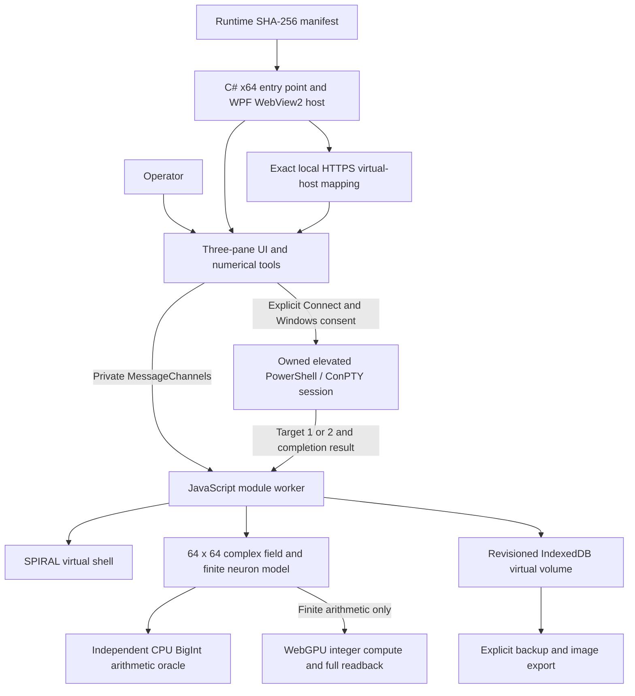

# LK / Vexa Machine

## JA21 Semi-sili XPU Console

**Console integration 1.4.0 · JA21 software CPU/XPU 2.4.0 · Windows x64 native presenter**

**Windows launch package:** [Download JA21-1.4.0-Windows-r1.zip](https://github.com/LKVexa/LK-Vexa-Machine/releases/download/v1.4.0-windows-r1/JA21-1.4.0-Windows-r1.zip), extract into a short parent such as `D:\Codex`, and open `JA21\Start Console.cmd` normally. GitHub **Code → Download ZIP** supplies development source; use the release asset to launch the pinned Windows build.

LK / Vexa Machine is a local computational research application combining a finite numerical XPU, two virtual command terminals, transactional browser storage, image-based state interchange, and an explicitly requested Administrator PowerShell connection. The default Windows application embeds its JavaScript module worker in a compiled C# / WPF WebView2 host. The optional browser profile serves the same application through a restricted localhost host and supports HERMIT WebSocket terminal transport.

The term **semi-sili** identifies the project's finite p-adic phase, bulk-bit sampling, and neuron-state model executed by the existing host CPU, RAM, and available GPU. The implemented numerical path is inspectable in source: CPU complex-phasor arithmetic is checked against an independent exact-integer oracle; a separately dispatched integer WebGPU kernel can confirm every finite-arithmetic result. Phase evolution and neuron updates run on the CPU. TIFF and GIF encode data interpreted by the application.

**Release qualification:** native x64 startup, worker execution, three-pane presentation, transactional recovery, and real browser GPU arithmetic have recorded passes. The full elevated PowerShell startup and Administrator-to-both-XPU delegation path remains **unverified**. An operator approved Windows consent during acceptance, but a blank Administrator pane and an incomplete run do not establish a pass. This release must not be described as fully verified for privileged terminal operation.

| Release identity | Value |
| --- | --- |
| Repository | `LKVexa/LK-Vexa-Machine` |
| Console integration | `CONSOLE_VERSION`: `1.4.0` |
| Software CPU/XPU | `applications/silicon/VERSION`: `2.4.0` |
| Native presenter compatibility | Root `VERSION`: `9.8.7` |
| Native target | Windows x64; compiled C# / .NET Framework / WPF |
| Embedded web adapter | Microsoft WebView2 SDK `1.0.4191.47` |
| Embedded application origin | `https://ja21-silicon.invalid/`, resolved locally by WebView2 |
| Primary source grant | GPL-3.0-only for the copyright holder's owned project material; retained component terms apply |
| Copyright | Copyright (C) 2026 RUSSELL PHILIP SMITHSON |

The version fields identify different components. The native compatibility value is not the software XPU version. Historical documents retain the versions and qualification scope applicable when they were written.

## Contents

1. [Distribution and installation](#distribution-and-installation)
2. [System architecture](#system-architecture)
3. [Finite numerical model](#finite-numerical-model)
4. [Memory and byte pipeline](#memory-and-byte-pipeline)
5. [State encoding and image interchange](#state-encoding-and-image-interchange)
6. [Persistence and recovery](#persistence-and-recovery)
7. [Three-pane terminal operation](#three-pane-terminal-operation)
8. [Administrator connection and delegation](#administrator-connection-and-delegation)
9. [Optional WebSocket transport](#optional-websocket-transport)
10. [Security and integrity boundaries](#security-and-integrity-boundaries)
11. [Build and verification](#build-and-verification)
12. [Qualification evidence](#qualification-evidence)
13. [Research traceability and interpretation](#research-traceability-and-interpretation)
14. [Repository map](#repository-map)
15. [Limitations and maintenance](#limitations-and-maintenance)
16. [License, notices, and attribution](#license-notices-and-attribution)

## Distribution and installation

### Recommended Windows artifact

Use the Windows release asset, rather than GitHub's automatically generated source ZIP, for installation:

[**JA21-1.4.0-Windows-r1.zip**](https://github.com/LKVexa/LK-Vexa-Machine/releases/download/v1.4.0-windows-r1/JA21-1.4.0-Windows-r1.zip)

| Artifact property | Recorded value |
| --- | --- |
| Archive size | 84,360,858 bytes |
| SHA-256 | `4be8908778c40b0003b6183378c951238252ed9bca48096453a674770cddbae1` |
| Runtime closure | All 358 sealed runtime members and the associated manifest preserved |
| Outer packaging | 377 members; complete historical source/reference archive retained as a nested archive |
| Windows extraction | Actual Windows .NET Framework extraction passed |
| Measured installed path | Maximum 123 characters at the tested short installation destination |
| Native package preflight | Passed |

The `r1` designation is a Windows packaging revision. It preserves the tested executable and mapped application closure. The older comprehensive source/reference layout contains historical long paths and caused Windows Explorer extraction problems. This Windows artifact places the operational closure at short paths while retaining the original archive for source and provenance.

### GitHub source ZIP and complete source history

The main branch's GitHub **Code → Download ZIP** export omits two historical VM trees through `.gitattributes` `export-ignore` rules, bounding exported source paths for Windows extraction into a short destination. The omitted trees are `substrate/DF_Large/vm/BOTTLE_ROCKET_4.7.0_COLUMNED_LCTL_VIRTUAL_DEVICE_IO_SERVICE_ARCHITECTURE_61K` and `substrate/DF_Xtra_Large/vm/QUORUM_LCTL_MSSL_2.1.0`. All 358 historical runtime members and the active C#/JavaScript/native build sources remain in the export. No source is deleted from the Git repository.

The source ZIP is a development archive. Its path fix does not convert it into the immutable Windows launch package or transfer existing binary qualification to changed source. Extract it to a short parent such as `D:\Codex`; avoid deeply nested destinations. The public-source overlays and historical seal caveat below still apply.

For every tracked file, including both historical VM trees, use a Git clone with long-path support and a short checkout directory:

```powershell
git clone --config core.longpaths=true https://github.com/LKVexa/LK-Vexa-Machine.git D:\Codex\LKM
```

The unchanged [original complete source/reference archive](https://github.com/LKVexa/LK-Vexa-Machine/releases/download/v1.4.0-windows-r1/JA21_Semi_Sili_XPU_Console_1.4.0.zip) also remains available as a release asset. It retains the original long member paths and is intended for provenance or extraction with long-path-capable development tools. Older tags keep their original archive policy; use the current main-branch source export for the path correction.

The current main-branch ZIP includes the compiled x64 presenter and a synchronized 358-member runtime integrity manifest. After extracting the complete ZIP into a short writable folder, open **Start Console.cmd** normally. The current seal covers the published package metadata and HERMIT notice as well as all previously sealed runtime code; integrity verification remains enabled. The original Windows release asset and its test pins remain unchanged.

The source tree also includes licensing/documentation overlays and a source-only resealer correction. The broader `package.integrity.json`, `FILES_MANIFEST.json`, and checksum ledgers remain records of the original complete distribution; they are not a current exact-set receipt for the filtered GitHub source export. Native startup verifies the current runtime manifest. Review, rebuild, reseal, and requalify later code modifications before distributing a new executable package. Original replaced files are preserved under `provenance/pre-publication/`; `provenance/GITHUB_SOURCE_PROVENANCE.json` records the initial publication transformation. The GPL/notice companion accompanies the byte-exact Windows release asset without modifying its historical bytes or test pins.

### Prerequisites

The native profile requires a Windows x64 environment with .NET Framework / WPF and an installed Microsoft Edge WebView2 Evergreen Runtime. The SDK adapter is included; the Evergreen browser runtime is a separately installed platform dependency. Administrator PowerShell uses Windows ConPTY and the installed Windows PowerShell executable. The default native launch requires neither Node.js nor Python, and does not require an ARM64 operating-system boot.

Hardware GPU confirmation additionally requires a secure WebGPU context, a usable adapter with explicitly nonfallback identity, adequate resource limits, successful device creation, shader dispatch, and exact readback. GPU availability can vary with browser version, Windows policy, adapter, and driver.

### Installation sequence

1. Download the Windows artifact and compare its SHA-256 with the value above or its release checksum sidecar.
2. Extract the complete Windows package into a short writable parent directory, such as `D:\Codex`. Its `JA21` top-level folder produces `D:\Codex\JA21`.
3. Open the extracted folder in File Explorer and double-click **Start Console.cmd** normally.
4. Wait for both **XPU 1** and **XPU 2** prompts. Use the virtual terminals and numerical tools without elevating the application.
5. If the privileged connection is needed, select **Connect PowerShell** in the third pane. Windows consent is a separate, explicit action.

Do not launch from inside the ZIP. Do not run the entire console as Administrator to work around a failed connection. For diagnostics, preserve the startup window and the exact error text. `Alt+F4` closes the native console; `Alt+Space` opens the Windows move/resize menu. `Start Console.cmd --blank` requests the retained blank host profile for inspection.

The native profile checks that the WebView2 user-data profile path is at most **150 UTF-16 characters** before attempting storage creation. If this guard fails, close the console and move the complete extracted directory, including `workspace/`, to a shorter path. The guard reports the failure without relocating or resetting the saved volume.

## System architecture

### Execution layers



The normal native path loads `JA21-Silicon-Console.exe`, validates the sealed application and SDK, and maps only `applications/silicon/dist/` to the reserved local HTTPS host. That address does not contact an Internet website. The stable origin gives module workers, Web Crypto, Web Locks, and IndexedDB a consistent secure-context identity.

The presentation process hosts WebView2; the computational worker owns the virtual server, filesystem, legacy byte lanes, resident field, and durable state transitions. Two XPU terminal sessions use that same worker and virtual volume. Their command inputs and shell environments are separate; their numerical state and virtual files are shared.

The original presenter, JA21 policy IR, VEC1 substrate, DF_Medium engine sources, and historical qualification material are retained for provenance and inspection. Their presence does not mean that every legacy engine, research proposal, or historical interface is on the active software-XPU execution path.

### Operational sequence

The ordinary execution sequence is:

```text
Native preflight
  -> verified WebView2 local mapping
  -> application modules and worker startup
  -> origin-specific writer ownership and validated volume load
  -> XPU session-open acknowledgments
  -> command / detached numerical preview
  -> CPU validation and, when requested, GPU dispatch plus readback
  -> explicit reviewed save
  -> one quota-checked durable volume transaction
  -> publish matching field and neuron state
```

A preview does not mutate committed numerical state. A newly prepared candidate carries a state token. Saving requires the current candidate, a valid token, applicable state/version checks, the required CPU/GPU qualification, and available virtual-storage quota. This distinction makes inspection and durable publication separate operations.

## Finite numerical model

The implementation provides a bounded, finite interpretation of the research terminology. The principal modules are [`semisili-core.js`](applications/silicon/src/lib/semisili-core.js), [`semisili-model.js`](applications/silicon/src/lib/semisili-model.js), and [`semisili-gpu.js`](applications/silicon/src/lib/semisili-gpu.js).

### Ring definition and exact arithmetic

For a prime `p` and integer precision `k`, the arithmetic domain is:

```text
R = Z / (p^k Z)
m = p^k
2 <= m <= 65,536
1 <= k <= 16
0 <= a, b < m
```

The prime check, precision bound, modulus bound, vector shape, canonical residue range, and finite numerical values are validated before processing. A batch contains at most 4,096 samples. The integrated resident field uses all 4,096.

| Operation | Canonical result |
| --- | --- |
| `add` | `(a + b) mod m` |
| `sub` | `(a - b) mod m`, normalized into `0..m-1` |
| `mul` | `(a × b) mod m` |
| `negate` | `(-a) mod m` |
| `complement` | `m - 1 - a` |

The independent CPU oracle evaluates these operations with JavaScript `BigInt`. The finite arithmetic is exact in its declared ring; the complex carrier used to model it is floating-point numerical state.

### Phase encoding and readout

A residue `r` is represented by the unit phasor:

```text
z(r) = cos(2πr/m) + i sin(2πr/m)
```

Addition uses normalized complex multiplication; subtraction conjugates the second carrier; multiplication uses integer exponentiation by repeated squaring; negation conjugates the first carrier; complement combines conjugation with the `m-1` carrier. Every decoded residue is compared with the exact oracle before output is accepted.

Readout uses `atan2`, nearest residue-cell rounding, a positive amplitude guard, and a decision-margin check. The default minimum margin is `0.49` cells, where a perfectly centered carrier has margin `0.5`. The model prepares Float64 carriers, then canonicalizes the persisted neuron amplitude and field to Float32 and checks the decoded residues again. Nonfinite, weak, ambiguous, or incoherent carriers are rejected.

### Sampling and hierarchical neuron update

Live-field sampling computes dimensionless intensity `I_i = re_i² + im_i²`. It quantizes each intensity relative to the finite frame peak:

```text
a_i = round((m - 1) × I_i / max(I)), or 0 for a zero-energy frame
u_i = 2a_i/(m - 1) - 1
bit_i = 1 when a_i >= m/2, otherwise 0
antiBit_i = 1 - bit_i
```

The p-adic distance utility uses the exact integer valuation `v_p`, with zero assigned infinite valuation and equality assigned distance zero. Finite neuron neighborhoods group integer addresses by congruence modulo `p^level`. The default binary address assignment reverses coarse Morton digits on the 64 × 64 grid so low-order base-2 digits describe coarse spatial branches. Other primes use finite integer addresses.

The neuron step is an explicitly bounded Euler approximation:

```text
s(x) = clamp(x, -1, 1)
mean_i = mean activation within the finite congruence class of address_i
x_i(next) = (1 - dt(leak + coupling)) x_i
            + dt(reaction s(x_i) + coupling mean_i + drive u_i + bias)
```

The integrated defaults are `dt=0.25`, `leak=1`, `reaction=1.5`, `coupling=0.25`, `drive=0.5`, `bias=0`, and `stateLimit=4`, with 1–32 steps per run. The implementation enforces stability and invariant-bound conditions before stepping and rejects an escaped/nonfinite result. It clamps only permitted floating-point boundary drift after that check.

The saved activation controls carrier amplitude through `1 + 0.5 × s(x)`, while the residue remains represented by phase. The result is a finite numerical neuron/phase field. A trained optimizer, a task-trained neural network, and an LLM are outside this implementation.

### Independent GPU confirmation

The WebGPU stage submits a separate WGSL `u32` kernel with a workgroup size of **64**. It uploads copied canonical operand vectors, dispatches the requested finite operation, copies the output to a mapped readback buffer, and compares **every returned element** with the CPU reference. With the modulus restricted to 65,536, the largest product `(65,535 × 65,535)` remains representable in an unsigned 32-bit word.

GPU-required acceptance needs a real API invocation, successful submission/readback, zero mismatches, and an explicitly nonfallback adapter. An injected test adapter produces fixture receipts and cannot provide hardware proof. An adapter with unknown fallback status can yield an arithmetic match but cannot qualify as hardware confirmation.

The default GPU deadline is 8,000 ms; the accepted configurable limit is 1–12,000 ms. Cancellation, device loss, allocation/validation/shader failure, readback error, timeout, or mismatch leaves the committed state intact. Buffers and devices belong to the individual invocation and are disposed on exit, including late device acquisition after cancellation. Receipt timings describe observed wall time and submit-to-readback time; they do not establish GPU timestamp measurements, hardware FLOPS, or energy consumption.

## Memory and byte pipeline

The capacities below describe logical payloads. Browser object overhead, JSON expansion, validation copies, temporary candidates, graphics buffers, and platform runtime memory are additional.

| Representation | Dimensions / layout | Payload |
| --- | --- | --- |
| Resident complex field | 4,096 Float32 real + 4,096 Float32 imaginary samples | 32,768 bytes / 32 KiB |
| Default bulk-bit input | Eight bit planes, 64 blocks, 64 samples per block, two `u32` words per plane/block | 4,096 bytes / 4 KiB |
| Maximum 16-bit bulk-bit input | Sixteen planes over the same field | 8,192 bytes / 8 KiB |
| Owned arithmetic input | 4,096 `Uint16` residues | 8,192 bytes / 8 KiB |
| Six legacy byte-processor outputs | Six × 4,096 `Uint8` values | 24,576 bytes / 24 KiB |
| Legacy selected output | 4,096 `Uint8` values | 4,096 bytes / 4 KiB |
| Legacy route identifiers | 4,096 `Uint8` values identifying a selected lane | 4,096 bytes / 4 KiB |
| Pixel160 cell | Five 32-bit words | 20 bytes / 160 bits |
| Pixel160 frame | 4,096 cells | 81,920 bytes / 80 KiB |
| GPU operand/reference vectors | `u32` storage per 4,096-element vector | 16,384 bytes / 16 KiB per vector |

The legacy `hpu bytes` path applies six fixed 256-entry byte lookup tables to sampled bytes and compares scalar and 32-wide batched JavaScript walks. Its historical variable names and simulated `cpuCycles` / `gpuWarps` counters describe the software model. Those counters are not hardware measurements, and this legacy path does not dispatch WebGPU. The real WebGPU confirmation belongs to the separate semi-sili finite-arithmetic path.

The legacy route chooses among those six outputs according to its deterministic selection rule. Repeated or constant lookup tables remain inspectable in `byte-tables.js`; six named processors do not imply six independent physical CPUs.

## State encoding and image interchange

### Pixel160 contract

The neuron profile uses five coordinate axes with shape **`[4, 4, 4, 8, 8]`**, a product of 4,096 cells. Coordinates are row-major with `D8` fastest. The five coordinate axes locate a cell; they are separate from its five storage-word lanes.

| Word lane | Canonical interpretation |
| --- | --- |
| 0 | Residue as an unsigned 32-bit word, validated against the selected modulus |
| 1 | Activation Float32 bit pattern |
| 2 | Amplitude Float32 bit pattern |
| 3 | Real carrier Float32 bit pattern |
| 4 | Imaginary carrier Float32 bit pattern |

The generic Pixel160 codec preserves arbitrary `u32` words exactly. The numerical neuron profile adds semantic validation: finite values, bounded activation, positive coherent amplitude, matching phase/residue, supported configuration, valid shape, and monotone history. Arbitrary opaque words are therefore not automatically a valid neuron field.

Current schema identifiers are `JA21-PIXEL160/1.0`, `JA21-SEMISILI-NEURON/1.0`, `JA21-SEMISILI-STATE/1.0`, and `JA21-PIXEL160-TIFF/1.0`. Canonical state has a **1.5 MiB** UTF-8 limit, bounded configuration depth/node count, and at most eight retained prior frames plus current state, subject to the volume quota.

### TIFF and GIF profiles

Pixel160 TIFF carries a single frame in a **20 × 4,096 unsigned-byte raster**, with explicit shape, word-lane roles, declared configuration, and CRC32. Five words per cell are serialized with explicit byte order. Metadata describes data; the application does not execute TIFF metadata.

The RUSSL field atlas is a different contract: **128 × 128 Float64 scalar sites**, representing the real, imaginary, intensity, and phase planes of the 64 × 64 complex field. Its real/imaginary values preserve the Float32 live field exactly; the larger atlas does not increase the number of resident complex samples. Intensity and phase are derived. Capture, import, and edits affect a staged atlas until an explicit apply operation.

The legacy `phase.tif` is a quantized, lossy visualization of complex phase. Legacy processor TIFFs retain declared byte-lane values. GIF exports represent display/intensity frames and bounded temporal presentation, rather than an autonomous instruction engine. These formats are not interchangeable simply because they all contain pixels.

Applying a staged live-field atlas resets dependent spool, recordings, byte-lane/counter state, and derived caches. Existing user TIFFs are not silently rewritten at startup. Use a full-volume backup when the surrounding state matters. The exact profile and accepted TIFF restrictions are specified in [`RUSSL_PIXEL_PROFILE.md`](applications/silicon/docs/RUSSL_PIXEL_PROFILE.md).

## Persistence and recovery

The virtual filesystem is a bounded in-memory POSIX-like tree whose committed snapshot is stored in IndexedDB. The legacy device key `nvme0n1` is retained for compatibility; it identifies a virtual volume record, not a physical NVMe block device.

| Persistence element | Contract |
| --- | --- |
| Normal database | `ja21-ssd`, object store `volumes` |
| Isolated browser acceptance database | `ja21-semisili-validation-v1` |
| Durable volume record | Version 2; SHA-256, revision, writer identity, previous committed record |
| Virtual filesystem contents | 2 MiB aggregate content quota |
| Backup envelope | At most 32 MiB UTF-8, accommodating JSON escape expansion |
| XPU binary state | HPU2, length/CRC32 and complete typed state; strict compatible HPU1 import |
| Filesystem snapshot | Version 1, validated into a detached tree before publication |
| Database open/transaction deadline | 5,000 ms for each bounded operation |

One application window owns the origin-specific writer lock. Multiple terminals within that window share its volume. Another window cannot become a competing writer. Durable writes compare the expected revision with the stored revision inside the transaction and refuse concurrent overwrite. The previous committed record is retained as recovery material; it is not an unlimited version history.

Commands and mutations trigger saves. `sync` explicitly flushes pending state. A numerical save builds and validates a detached quota-checked candidate, then publishes the field and neuron bank together only after the durable transaction. Cancellation before the commit boundary prevents publication; once the transaction begins, the application reports that commit is underway instead of claiming the durable write was cancelled.

Corrupt or unsupported stored state is not overwritten with a factory volume. Preserve raw recovery exports when available, then restore a validated known-good backup. A rejected restore must leave the existing committed state intact. Export complete backups from **Virtual storage** before upgrades, path/profile changes, or experiments that matter.

Storage identity depends on browser profile and origin. The native profile stores WebView2 data under `workspace/`; changing URL host or port in browser mode selects another origin. Neither an origin change nor copying application files automatically migrates a browser volume. Restored GPU receipts are historical data until a new run supplies fresh in-memory proof.

Persistent-storage permission is an optional browser grant. The recorded live browser acceptance did **not** receive that grant. Browser storage can be cleared, evicted, or lost with a damaged profile, so exported backups remain part of the operational procedure.

## Three-pane terminal operation

The Console view presents **XPU 1**, **XPU 2**, and **Administrator PowerShell** concurrently. Every pane has its own command box, Run/Stop controls, rendered viewport, and text transcript. Narrow windows stack the panes.

XPU 1 and XPU 2 are independent virtual shell sessions over the same worker and numerical state. Each has its own working directory and shell environment. The UI resolves a submitted command against that pane's session rather than a shared focused-terminal variable. Session-open acknowledgment determines the connected state. Pending opens, late acknowledgments, removed records, and worker faults are fenced so stale callbacks cannot repaint or reuse another pane's session.

Run these commands individually in either XPU pane:

```text
help
xpu info
echo "hello virtual volume" > /tmp/hello.txt
cat /tmp/hello.txt
hpu gate xor 1 0
hpu bytes
sync
```

The `xpuinfo` compatibility command and `hpu` command family remain available. The command library exposes registered commands and their usage. This bounded SPIRAL interpreter supports pipes, redirection, history, virtual files, and interruption; its syntax and capability set are deliberately smaller than a general Windows or Unix shell.

For a detached finite-arithmetic preview:

```text
xpu run add 1 2 8 4 gpu field
```

The positional arguments are operation, scalar operand, prime, precision, neuron step count, confirmation mode, and source. Defaults are `add 1 2 8 4 gpu field`. Use `cpu` explicitly for CPU preview without hardware GPU confirmation; use `bank` to continue a compatible saved neuron bank. The result prints its receipt, token, and `canApply` decision.

After reviewing a successful preview, save its actual printed UUID token:

```text
xpu save <preview-token>
```

The angle-bracket token above is a placeholder, not literal input. A stale, displaced, failed, cancelled, or insufficiently confirmed preview cannot be saved as a newly validated result. `poweroff` stops the virtual worker server and saves its volume; it does not power down Windows. Reboot starts a fresh worker after the bounded save/stop sequence.

## Administrator connection and delegation

### Authority and lifecycle

The third pane is a distinct Windows host capability. Its commands execute in an owned PowerShell process with the authority granted by Windows consent. The ordinary console process and XPU interpreter do not become elevated merely because the pane exists.

The intended sequence is:

```text
Disconnected
  -> explicit operator Connect PowerShell
  -> local IPC preflight and sealed-helper verification
  -> Windows runas consent
  -> helper identity / nonce / elevation authentication
  -> ConPTY PowerShell startup and session-open acknowledgment
  -> input / output / resize / interrupt / delegation
  -> explicit close, owned process-job termination, disconnected
```

The default supported consent model is the **same signed-in Windows account** using its split Administrator token. Another-account credential elevation has not been validated and is outside the current acceptance contract. The whole application should be launched normally; accepting the third pane's Windows consent is the explicit privilege transition.

The native implementation uses a protected named-pipe ACL for the signed-in user, cryptographic rendezvous nonces, actual named-pipe client/server process identifiers, exact process-image checks, a fresh session identifier, and an explicit elevated-role check before PowerShell creation. The fixed helper is verified against the runtime manifest before it is launched. The browser bridge admits the sealed entry document, current document token, and current session, with generation fencing and bounded queues.

PowerShell is attached through ConPTY and assigned to an owned kill-on-close Windows job. A closed connection disposes its owned session. Reconnection starts a fresh session and does not replay input or retry commands automatically. Startup avoids arbitrary user profiles; session initialization does not change Windows execution policy or weaken the named-pipe ACL.

### Delegation interface

Within the connected Administrator PowerShell pane:

```powershell
$first = Invoke-JA21Terminal -Terminal 1 -Command 'xpu info'
$first.output
$first.code

$second = Invoke-JA21Terminal -Terminal 2 -Command 'echo delegated > /tmp/task-result; cat /tmp/task-result'
$second.output
$second.code
```

`-Terminal` accepts **1 or 2**. A delegated command runs in the existing target XPU session and is visible in that pane. The target must already exist, be idle, and have an empty pending command line. Delegation grants access to the bounded virtual interpreter, while directly typed PowerShell commands retain Windows administrator authority.

The completion reply is correlated with a unique request ID and the actual target command completion hook. It reports the real exit code and at most 64 KiB of UTF-8 output, with an explicit truncation flag. The completion follows the command's storage flush; a flush failure reports failure. Admission/input acknowledgment is not completion. Interruption, a lost connection, a stale epoch, or an indeterminate outcome yields **UNKNOWN**, with no automatic retry. A request ID cannot be reused within a worker epoch.

| Administrator protocol bound | Maximum |
| --- | --- |
| Input text | 8,192 UTF-8 bytes |
| Ordinary JSON control | 65,536 bytes |
| Raw delegated output | 65,536 UTF-8 bytes |
| Escaped delegation-result frame | 524,288 bytes |
| Terminal geometry | 2–400 columns, 1–200 rows |
| Completed exit code | Integer `0..255` |

The protocol rejects duplicate JSON keys, unsupported fields/operations, malformed types, invalid lengths, stale session identifiers, and invalid outcomes. See [`TERMINALS.md`](applications/silicon/docs/TERMINALS.md), [`HostAdminBridge.cs`](host/HostAdminBridge.cs), [`AdminTerminal.cs`](host/AdminTerminal.cs), and [`xpu-delegation.js`](applications/silicon/src/lib/xpu-delegation.js).

### Acceptance status

Native compilation, protocol fixtures, ordinary worker delegation, document-origin checks, and process-boundary policy tests are recorded separately from live elevation. The remaining live gate must demonstrate actual Administrator PowerShell startup, dispatch to **both** panes, target-specific visible output, exact completion/exit-code correlation, persistence of the delegated virtual writes, owned PowerShell exit, and continued XPU operation after the privileged connection closes.

The supplied ordinary-session procedure is in [`ADMINISTRATOR-ACCEPTANCE.md`](docs/ADMINISTRATOR-ACCEPTANCE.md). Approving consent alone does not satisfy it. A blank pane, early close, timeout, or incomplete report remains incomplete. Restrictive AppContainer tool environments can deny access to the deliberately user-only pipe; granting package access or weakening Windows policy is not an acceptance substitute.

## Optional WebSocket transport

**Start WebSocket Console.cmd** selects the optional localhost browser profile. The launcher provisions a private, hash-verified official Node.js runtime on first use and verifies the cached executable on subsequent launches. The component's runtime lock pins Node.js **24.21.0** for supported Windows bootstrap architectures. Native x64 console launch does not need it.

The optional server binds only to `127.0.0.1`. Its worker-owner and terminal-client endpoints relay to the one existing XPU worker; opening a terminal client does not create a second independent numerical engine. Admission uses exact Origin/Host checks and short-lived, single-use role tickets. Tickets are carried outside the URL. Authentication does not request elevation.

The transport families are distinct:

| Interface | Version / framing |
| --- | --- |
| Internal local worker control | `hermit.vws.v3`, structured control `v: 3` |
| Optional HERMIT WebSocket terminal | `hermit.vws.v2` |
| Administrator bridge | `ja21.admin.v1` / version-1 controls |
| HERMIT binary data | Seven-byte header: one kind byte and a 48-bit sequence |
| Owner multiplexing | Additional four-byte channel identifier |
| Input / output data chunks | At most 8 KiB / 16 KiB |

Bounded queues, message counts, sequence validation, and output credit constrain the relay. Output credit can pause the original worker. Input acceptance describes admission; the separate delegation completion path provides completed command results.

The native default has `connect-src 'none'` and starts no network listener. The optional browser server permits only its exact local HTTP/WS origin. No public endpoint, LAN binding, or deployment service is part of the qualified profile. Keep the same browser host and port to retain the same origin's volume.

## Security and integrity boundaries

The implementation's relevant boundaries are concrete and inspectable:

- **Mapped-resource containment:** only the sealed distribution tree is mapped. Path validation rejects linked/reparse-point escapes and unsafe paths. Host executable payloads are not served as mapped application content.
- **Document policy:** the native entry carries one restrictive Content Security Policy before module execution, plus `no-referrer`. The policy restricts scripts/workers/styles to local application resources and forbids ordinary network connections, object embeds, base changes, and form actions.
- **Native bridge admission:** only the expected entry document and current session/document token can invoke the Administrator bridge. There are no general host objects exposed to page code.
- **Privilege separation:** elevation is requested through the explicit Administrator connection. The XPU virtual filesystem has no general Windows command-shell authority.
- **Persistence integrity:** detached validation, quota checks, writer ownership, expected revisions, transaction completion, and restore validation protect the committed virtual state.
- **Numerical integrity:** exact CPU oracles, readout guards, canonical Float32 revalidation, explicit GPU coverage, complete readback, and stale-preview checks prevent a partial match from becoming a qualifying save.
- **Failure containment:** bounds, deadlines, epoch/session fencing, explicit UNKNOWN outcomes, late-result disposal, and no automatic replay limit stale or ambiguous work.

The runtime and package manifests contain SHA-256 integrity records, not publisher signatures. They establish equality with a reviewed manifest; they do not independently authenticate an untrusted publisher or a manifest replaced along with its payload. Modified builds require their own review, new integrity records, and new qualification evidence.

WebView2 virtual-host metadata cannot claim every response-header-only protection. In particular, HTTP-only `frame-ancestors` and cross-origin isolation are not inferred from the HTML metadata overlay. The platform's Windows, WebView2, graphics-driver, and account security properties remain prerequisites.

## Build and verification

### Development prerequisites and workspace

Use a separate, short source checkout. Node.js **22.12.0 or newer** is declared by the component, with the recorded qualification using the pinned Node.js 24.21.0 runtime. The JavaScript application has zero third-party npm runtime/build dependencies. Python 3 is used by package/manifest and some optional independent codec tools. Native compilation uses the Windows .NET Framework 4.x x64 C# compiler, WPF reference assemblies, and the included WebView2 SDK adapter.

Do not build over the only copy of a user's `workspace/`. Run qualification with a separate WebView2 profile/virtual volume. The application and tests distinguish a pure fixture, a real worker, an actual browser API call, and a complete native host invocation; those scopes should remain visible in new reports.

### JavaScript core

From a developer checkout in PowerShell:

```powershell
Set-Location .\applications\silicon
node scripts\build.mjs
node scripts\check.mjs
node scripts\test.mjs
```

The combined core gate is:

```powershell
node scripts\verify.mjs
```

It rebuilds the static distribution, checks syntax/import/version contracts, and runs the offline test suite. It records a fresh RUNNING state before execution and FAIL on error so an old report cannot be mistaken for the current run. A core pass alone does not qualify browser persistence, a real GPU, or an elevated Windows terminal.

The static builder stages a complete candidate under an owned directory, refuses linked/special inputs, and publishes by rename with rollback. `src/` and `web/` are development inputs; `dist/` is generated output. The mapped runtime source and its matching distribution must ship together.

### Native host and acceptance executable

Return to the repository root and run:

```powershell
.\host\Build-SiliconConsole.cmd
.\tools\Build-Silicon-Acceptance.cmd
```

The host build compiles both `tools/JA21-Admin-Terminal.exe` and `JA21-Silicon-Console.exe`. The acceptance build produces `tools/Test-Silicon-WebView2.exe`. Both use `/platform:x64`, `/warn:4`, and `/warnaserror+`. Build scripts contain the exact source lists, references, entry points, and compiler selection.

Integrity verification must follow an intentional reviewed rebuild. `tools/reseal.py` regenerates development manifests and `tools/silicon_package.py` validates the mapped application contract. The publication's source correction retains the previous runtime manifest's validated inventory, explicitly requires the Administrator bridge/helper, includes current mapped assets, and hashes the current files. It accepts an existing supported inventory across an intentional version bump; the newly written seal records the current `VERSION`. Missing required members, malformed/escaping paths, or unsupported inventory format stop the process. Preserve the original release's manifests and evidence separately; resealing modified content does not transfer the old runtime's qualification to new bytes. Bit-for-bit reproducibility of arbitrary C# rebuilds is not asserted by this release.

The recorded production runtime seal has 358 entries. Use that manifest as the immutable historical reference for the shipped binary. The inherited generic resealer predated additional source/helper/gateway sealing and omitted part of that inventory; a source-only correction accompanies this publication. An isolated ZIP-backed fixture executes the corrected inventory/hash-writer statements with the real path validators: it matches all 358 original members and their byte lengths/SHA-256 values, rejects traversal and a missing required helper before runtime publication, and restores required Admin members to an otherwise incomplete prior inventory. This fixture does not assert full-script filesystem publication or native runtime qualification. The Windows binary artifact is unchanged by the source-tool correction. Review and explicitly maintain the complete closure when adding or intentionally retiring members; successful hashing alone is not a completeness audit.

The retained policy/native-engine build path is separate:

```powershell
& '.\Rebuild JA21 Engine.cmd'
```

It rebuilds JA21 policy IR and the native DF_Medium engine and performs its associated regression checks. It does not replace the JavaScript software-XPU build.

### Independent and live checks

Optional independent tests require their documented Python/browser dependencies:

```powershell
Set-Location .\applications\silicon
node scripts\make-tiff-examples.mjs
python tests\russl_interop.py
python tests\codecs.py
node tests\browser-production.mjs
```

The offline UI test `tests/browser_offline.py` uses an explicit in-memory link adapter and must remain labeled as a fixture. The production-browser runner uses the actual worker and browser storage. Native acceptance is available through **Test Silicon CPU.cmd** and the detailed native acceptance documents. Browser **System & limits** links an isolated validation kit that checks arithmetic, save/reload, TIFF round-trip, writer exclusion, and rejected-restore retention and exports a JSON receipt.

Reproduction of a test count should use the exact source revision, runtime version, platform, and test command recorded with that report. Architecture-dependent skips must be reported as skips. Native x64 qualification does not certify ARM64 execution.

## Qualification evidence

The primary current machine-readable report is [`evidence/hermit/RELEASE_VALIDATION.json`](evidence/hermit/RELEASE_VALIDATION.json). Historical component reports are retained with their original dates, versions, and limitations. Source and evidence preservation should not be read as current certification of every retained component.

| Check | Recorded result | Scope and important limit |
| --- | --- | --- |
| Canonical engine regression | 461 total; 458 passed; 3 platform skips; 0 failed; 0 cancelled | Core/worker/transport/model regression, including explicitly identified fixtures |
| Static JavaScript/import checks | 97 syntax files; 90 resolved local imports | Static validation; no hardware execution inferred |
| Native host/helper/acceptance compilation | Pass, x64, warnings as errors | Actual C# compilation |
| Native policy acceptance | 46/46 checks passed | Origin/mapping/policy contracts |
| Administrator boundary acceptance | 32/32 checks passed | Protocol/security fixtures; no live elevated delegation claim |
| Three-pane UI | Passed | Independent inputs and narrow-window stacking |
| Live browser finite arithmetic | Five operations × 4,096 samples = 20,480 exact comparisons; zero mismatches | Actual WebGPU dispatch/readback, `fixture=false`, `fallback=false`, Intel `xe-lpg` adapter metadata |
| Live browser persistence | Reload recovery, writer exclusion, TIFF round-trip, invalid-restore retention passed | No persistent-storage permission grant |
| Native WebView2 acceptance | 8/8 checks passed | Actual native WebView2 worker/byte-lane/storage/restore path |
| Native host process relaunch | Passed | Distinct actual production-entry processes; exact virtual-file and full phase/intensity preview recovery |
| Windows packaging revision | Actual extraction and native preflight passed | Same tested 358-member runtime closure |
| Live Administrator startup and both-pane delegation | **Incomplete / unverified** | Human consent was observed in a later attempt; successful startup and full correlated execution were not established |
| Native WebView2 GPU computation | **Not run** | Real GPU qualification above used the live browser profile |
| Exit of every WebView2 broker process | **Not asserted** | Host-process relaunch recovery passed |
| Native ARM64 startup | **Not run** | Published compiled presenter targets x64 |

The Windows bundle and full source archive have different packaging hashes. The immutable original full source/reference archive was:

```text
JA21_Semi_Sili_XPU_Console_1.4.0.zip
Bytes: 81,457,471
SHA-256: d3b2b9eb7f76d899275ca0683f21343c464896a281ea264d1e9198587694ec03
```

The Windows revision retains that original archive byte-exact as nested source/provenance material. Repackaging is not a new numerical qualification. GPL/NOTICE/README publication updates likewise do not retroactively alter recorded binary test results.

## Research traceability and interpretation

The retained research intake comprises **26 documents: 25 PDFs and one setup text**, covering 350 PDF pages. The literature analysis maps finite mathematics, host interfaces/hardware boundaries, and image-storage contracts to implementation modules and explicit exclusions. See [`SEMISILI-XPU.md`](docs/SEMISILI-XPU.md), the component's [`SEMISILI-XPU.md`](applications/silicon/docs/SEMISILI-XPU.md), and the literature reports and provenance records retained with the references.

| Research concept | Implemented interpretation |
| --- | --- |
| p-adic / 2-adic arithmetic | Finite residue rings, exact valuation utilities, congruence-ball addresses, and bounded phase encoding |
| Holographic phase processing | Numerical complex phasors with guarded readout and exact-integer comparison |
| Bulk-bit RAM sampling | Packed bit planes and bounded typed-array sampling of the resident field |
| Neuron evolution | Finite bounded Euler update with clipped activation and normalized finite-neighborhood mean |
| Pixel / penteract storage | Explicit five-axis indexing and five-word Pixel160 cell serialization |
| CPU/GPU confirmation | CPU exact oracle plus separately dispatched GPU integer arithmetic and full readback |
| TIFF/GIF computation interfaces | Declared numerical state/interchange and display profiles interpreted by software |
| C# harness | Independent/native reference and host verification within its separately recorded scope |

No result here establishes an optical circuit, a quantum state measurement, black-hole physics, negative energy, independent in-DRAM computation, a universal ARM instruction-set emulator, or a trained LAMB/LLM system. Those subjects occur in the reference corpus; the implemented mapping is the finite software model above. The laptop's CPU and GPU provide the actual physical execution resources. Any future physical-device or performance claim requires a separate measurement design and evidence record.

Reference documents are source material. Embedded commands, installation suggestions, deployment recipes, and proposed architectures are not automatically executed or accepted as operational authority.

## Repository map

| Path | Responsibility |
| --- | --- |
| `README.md` | Current repository overview, operational contract, qualification summary |
| `LICENSE`, `NOTICE`, `COPYRIGHT`, `LICENSING.md` | Project grant, attribution, and component licensing map |
| `CONSOLE_VERSION`, `CONSOLE_BUILD.json`, `VERSION` | Integration, engine, and native compatibility identities |
| `Start Console.cmd` | Default native console launch |
| `Start WebSocket Console.cmd` | Optional localhost/WebSocket profile |
| `host/SiliconConsoleEntry.cs` | Compiled native console entry |
| `host/SiliconApp.cs` | Local origin, mapping, content policy, and mapped-resource checks |
| `host/LiveWebBridge.cs` | WebView2 integration and lifecycle |
| `host/HostAdminBridge.cs`, `host/AdminTerminal.cs` | Explicit Administrator bridge, named-pipe protocol, ConPTY, and owned process job |
| `applications/silicon/src/app.js` | Application UI, pane/session coordination, preview/review controls |
| `applications/silicon/src/lib/semisili-*.js` | Finite core, neuron model, Pixel160 codec, and real GPU confirmation |
| `applications/silicon/src/lib/xpu-delegation.js` | Target-session dispatch and completion correlation |
| `applications/silicon/src/lib/admin-link.js` | Browser-side Administrator session protocol |
| `applications/silicon/src/lib/ram-link.js` | Worker transport and lifecycle |
| `applications/silicon/src/lib/ramws/` | Browser HERMIT codec, owner, client, and wire adapters |
| `applications/silicon/src/vendor/spiral/` | Virtual kernel, shell, filesystem, storage, legacy field/byte model, TIFF codecs |
| `applications/silicon/src/vendor/vt/` | Terminal parser, screen, Canvas renderer, accessibility transcript |
| `applications/silicon/web/` | Static source documents and styles |
| `applications/silicon/dist/` | Generated and runtime-sealed mapped application |
| `applications/silicon/scripts/` | Build, host, verification, Node bootstrap, and optional gateways |
| `applications/silicon/tests/` | Regression tests, reference vectors, and explicitly labeled fixtures |
| `applications/silicon/native/` | C# numerical/reference harness and reproduction guidance |
| `docs/` | Native/terminal acceptance, implementation specifications, retained architecture history |
| `evidence/hermit/` | Current integration, browser, native, and release evidence |
| `applications/silicon/audit/` | Component audits, test outputs, provenance, historical scaffold archive |
| `applications/silicon/references/` | Retained input literature and packages outside the served distribution |
| `runtime/webview2-sdk/` | Included Microsoft SDK adapter and provenance |
| `engine/ja21/runtime.integrity.json` | Active runtime SHA-256 closure |
| `package.integrity.json`, `FILES_MANIFEST.json`, `SHA256SUMS.txt` | Package inventories and integrity records |
| `provenance/pre-publication/` | Original bytes of files replaced by the public-source licensing/documentation/tool overlays |
| `provenance/GITHUB_SOURCE_PROVENANCE.json` | Source-import and publication-overlay provenance |
| `source/`, `engine/`, `substrate/`, `corpora/`, `helper/` | Retained JA21/native substrate, sources, and historical provenance |
| `workspace/` | Mutable local application/profile state; excluded from immutable publication |

The original source audit records **191 pre-existing absent historical reference files**. That inherited inventory finding is retained in provenance and does not mean those files are part of the verified active runtime. Mutable workspace state, private browser profiles, caches, and transient test output are not source dependencies for redistribution.

## Limitations and maintenance

The qualified native distribution is x64. JavaScript being portable does not establish that its Windows presenter, SDK loader, C# references, ConPTY path, or bootstrap has been executed successfully on every architecture. ARM64 hash/PE/launcher contracts are distinct from actual ARM64 startup.

GPU receipts qualify only the declared finite arithmetic stage and observed adapter/run. CPU wave and neuron stages remain numerical CPU operations. A historical receipt, synthetic adapter, fallback renderer, absent WebGPU API, unknown adapter classification, or one mismatching element cannot qualify a new GPU-required save.

The UI is a bounded virtual console, not a complete operating-system emulator. Its virtual files, named virtual device, and simulated counters should be interpreted according to their storage/model contracts. The Administrator connection is a separate Windows facility with a remaining live qualification gate.

Pinned SDK and optional Node versions are reproducibility inputs rather than automatic security-update channels. Maintenance should review upstream updates, rebuild from reviewed sources, regenerate integrity records, repeat applicable gates, and publish new evidence tied to the changed bytes. No live advisory-database scan, long-duration reliability campaign, institutional accreditation, or third-party security certification is claimed.

For issue reports, include the console and engine versions, native/browser profile, Windows architecture, exact error, relevant redacted result JSON, and the smallest reproducible command sequence. Preserve backups before investigating data problems. Do not place host credentials, private virtual-volume contents, or browser profiles in a public issue.

## License, notices, and attribution

Copyright (C) 2026 **RUSSELL PHILIP SMITHSON**.

The copyright holder's owned project sources, integration, and publication changes are offered under **GNU General Public License version 3 only (`GPL-3.0-only`)**. Read the complete [`LICENSE`](LICENSE), [`NOTICE`](NOTICE), [`COPYRIGHT`](COPYRIGHT), and [`LICENSING.md`](LICENSING.md) before redistribution. The project is provided without warranty as specified by the license.

The repository retains component-level copyright and licensing records. Previously Apache-licensed material retains its Apache notices; Microsoft WebView2 SDK components remain under Microsoft's included terms; separately installed Windows/.NET/WebView2 platform software remains under its vendor terms; imported third-party packages and reference documents retain their own terms. The project grant does not claim ownership of third-party material or replace its notices.

Historical imported package declarations and archived notices remain provenance records. The current publication's explicit owned-material grant and component licensing map govern their interpretation; an inherited `private` or `UNLICENSED` package field should not be used to erase a third party's rights or infer a grant for material the publisher does not own.

Retain the applicable license text, attribution, notices, and corresponding source obligations when redistributing covered binaries or modified versions. Research references and included archives are not endorsed by their original authors merely because they are retained here.
